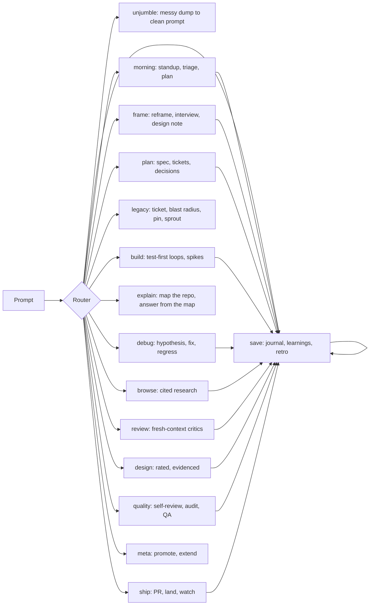

# ferret

Ferret is your dedicated dev-day companion. It routes each task to its
workflow on its own. It saves everything it learns.

<p align="center">
  <strong title="English" aria-label="English">🇬🇧</strong> ·
  <a href=".github/readme/README.zh-CN.md" title="简体中文" aria-label="简体中文">🇨🇳</a> ·
  <a href=".github/readme/README.es.md" title="Español" aria-label="Español">🇪🇸</a> ·
  <a href=".github/readme/README.pt-BR.md" title="Português (Brasil)" aria-label="Português (Brasil)">🇧🇷</a> ·
  <a href=".github/readme/README.ja.md" title="日本語" aria-label="日本語">🇯🇵</a> ·
  <a href=".github/readme/README.vi.md" title="Tiếng Việt" aria-label="Tiếng Việt">🇻🇳</a> ·
  <a href=".github/readme/README.ko.md" title="한국어" aria-label="한국어">🇰🇷</a> ·
  <a href=".github/readme/README.fa.md" title="فارسی" aria-label="فارسی">🇮🇷</a> ·
  <a href=".github/readme/README.th.md" title="ภาษาไทย" aria-label="ภาษาไทย">🇹🇭</a> ·
  <a href=".github/readme/README.ar.md" title="العربية" aria-label="العربية">🇸🇦</a> ·
  <a href=".github/readme/README.fr.md" title="Français" aria-label="Français">🇫🇷</a>
</p>

> English is canonical. Translated guides track the install commands. Their
> prose may lag the 1.0 release.

## Purpose

You describe the work. Ferret classifies it, names its mode in one line, and
runs that workflow. Example mode line:

```text
Mode: review — PR diff needs critics
```

Each reply stays action-first: the next action comes first, ferret numbers
the steps, restates the state, and ends with one concrete next step. Say
`normal mode` to suspend ferret for the session.

## How it works



One install brings the whole companion. There is no per-workflow setup.
The router reads one section file per task and runs it. The save phase
records the journal entry, the insight, or the handoff.

## Install

Paste this into your CLI prompt:

```text
Install the ferret skill/plugin from https://github.com/banavasi/ferret, refer to the repo's AGENTS.md for instructions.
```

Or read [INSTALL.md](INSTALL.md) for per-runtime steps.

## Layout

- `skills/ferret/SKILL.md` — the router. Read it first.
- `skills/ferret/sections/` — one file per day phase. Ferret loads one per task.
- `agents/` — named workers: `ferret-worker`, `ferret-cartographer`,
  `ferret-critic`, `ferret-codex-critic`.
- `hooks/` — opt-in always-on injection, the per-turn router hint, and the
  project hooks below.
- `docs/design/superagent-roles.md` — where the roles, tickets, and hooks
  come from.

## Project hooks

These run only in a project that has `.ferret/`:

- **Session brief.** Each session starts with the project rules, the last
  handoff, open tickets, and the map stamp.
- **Unjumble.** A messy, run-on, or typo-heavy prompt is restated as a clean
  prompt before work starts.
- **Legacy guard.** Globs under `protected` in `.ferret/config.json` ask before
  an edit. Globs under `legacy` get one blast-radius reminder per file.
- **Review ledger.** Changed files with no review produce one reminder when the
  turn ends. Set `"reviewGate": "block"` to hold the turn until critics run, or
  `"off"` to silence it.
- **Worker contract.** A `ferret-worker` that ends without its `Status:` report
  is sent back once.
- **40% compact rule.** At 40% context used, the turn is held once: ferret
  writes the handoff and the journal entry, then asks you to type `/compact`
  (or `/clear`). The next session start restores the handoff. Tune it with
  `compactAt` and `contextWindow` in `.ferret/config.json`. No hook can run
  `/compact` for you. This one also runs under the always-on flag.
- **Stripped record.** Before that, and before every compaction, a program
  (`hooks/strip.mjs`) writes the session to `.ferret/raw/<session>.md` with tool
  calls, reasoning, and injected text removed. It is plain code and regular
  expressions: no model, no tokens. By hand:
  `node hooks/strip.mjs <transcript.jsonl> <out.md>`.

One more hook runs once per machine, in the first session after install: it
lists your other plugins and personal skills and asks which to keep. What you
drop is disabled, never uninstalled. Delete `~/.claude/.ferret-onboarded` to be
asked again.

The Codex critic needs the `codex` CLI. It sends the diff to the Codex provider.

Say `set up this project` once per repo. Ferret creates the gitignored
`.ferret/` channel: inbox, handoff, learnings, and config.

## Limits and known problems

- Translated guides track commands only. Their prose lags the 1.0 release.
- Second-model critics need a second model CLI on the machine. With one
  model, critics use fresh contexts on the same model.
- The security step is a checklist pass, not a full audit.

## License

[MIT](LICENSE). Derivation credits: [NOTICE](NOTICE.md).
